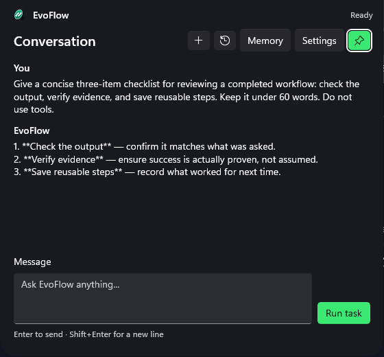
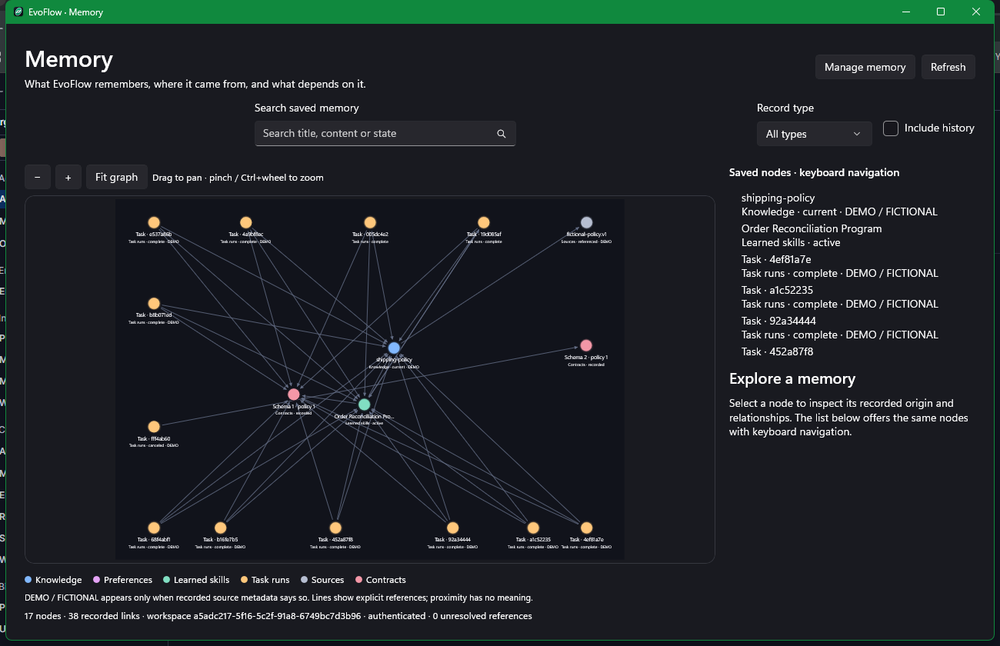
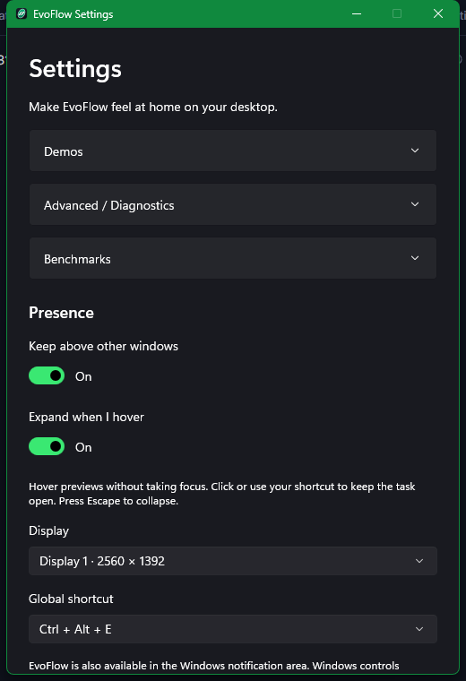
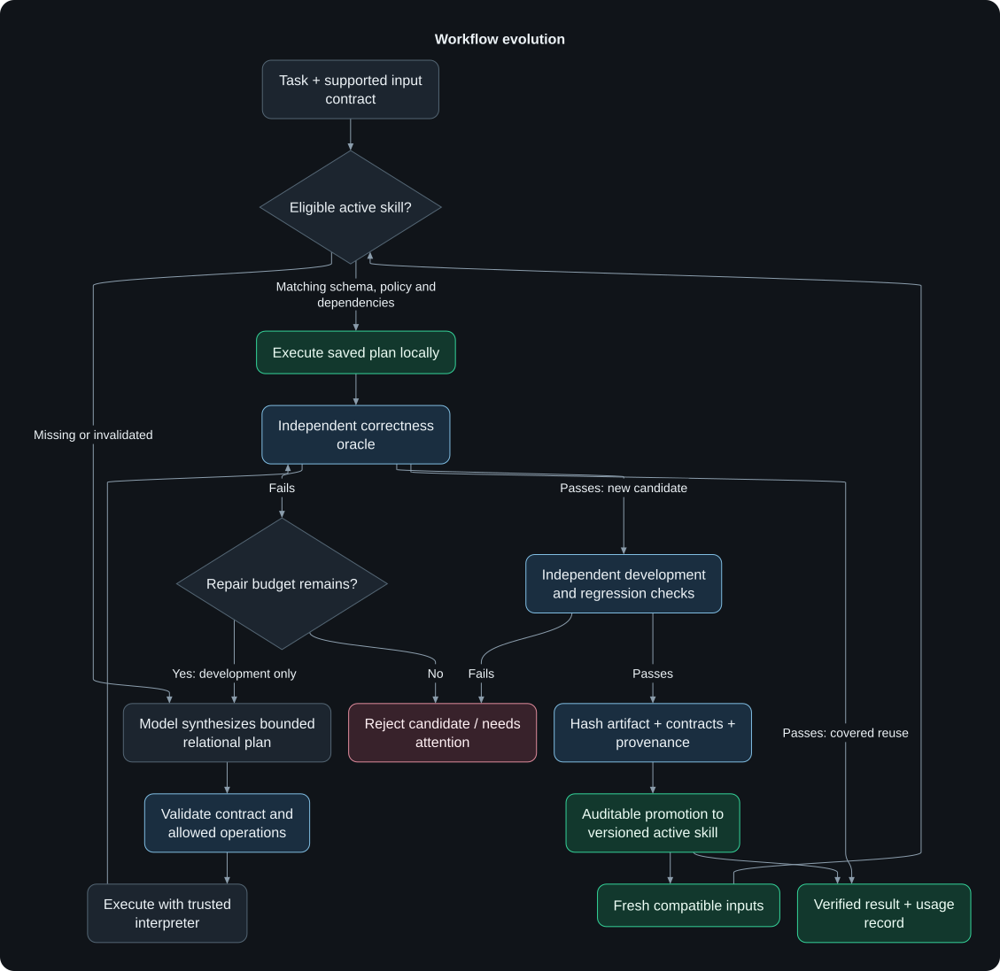
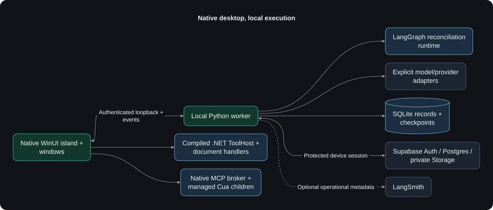

<p align="center"></p>
<h1 align="center">EvoFlow</h1>
<p align="center"><strong>A native Windows companion that turns verified workflows into reusable skills.</strong></p>
<p align="center">WinUI 3 · Python / LangGraph · Local execution · Supabase · Optional LangSmith</p>
<p align="center">
  <a href="#meet-evoflow">Tour</a> · <a href="#workflow-evolution">Evolution</a> ·
  <a href="#run-from-source">Get started</a> · <a href="#validation">Build & test</a> ·
  <a href="#evidence-and-boundaries">Evidence</a>
</p>

Talk to a compact desktop island, use registered local tools with native
approvals, and explore the provenance of saved knowledge. In the explicit
reconciliation demo, a model writes a bounded executable plan; independent
checks decide whether it earns a place in the versioned skill library.
Covered fresh inputs can then run locally without another model request.

Built for **HUMAIN Future AI Builders Hackathon · Challenge 2: Deliver AI with
Less Compute**. This working prototype includes limited-scope measured evidence.
It makes no dollar, GPU, energy or general quality claim.

## Meet EvoFlow

<p align="center"></p>
<p align="center"></p>

**Small when idle, useful when open.** Hover to preview, click to keep the panel
open, or press **Ctrl+Alt+E**. Enter sends a message; Shift+Enter adds a line;
Escape collapses the island. Settings, task results and Memory open in native
windows. The notification-area menu offers Open, Memory, Pause/resume, Settings
and Quit. Windows controls whether its icon appears beside the clock or in overflow.

| Available today | What it does |
| --- | --- |
| Conversation and history | Actual provider responses, bounded context within one chat, New Chat isolation, durable local history. |
| Model and effort routing | Typed Decisions routing selects a configured generation model and supported effort. Generation failures surface explicitly. |
| Native local tools | File operations, installed-app discovery/launch, approved console commands, accessible Windows controls, and structured DOCX/PPTX/XLSX/PDF handlers. |
| MCP connections | Native stdio and Streamable HTTP clients, discovery, schema validation, protected credentials and bound approvals for admitted contracts. |
| Memory explorer | Search, filters, pan/zoom, record details and navigation through actual stored provenance/dependency links. |
| Workflow demonstration | Reconcile fictional orders, inventory and shipments; acquire, check, version, reuse and adapt model-authored plans. |
| Optional monitoring | Metadata-only LangSmith traces with run/session correlation and provider usage receipts. |

<details>
<summary><strong>More of the real native interface</strong></summary>

<p></p>
<p></p>

These are captures of the running Windows application. The graph represents
saved records and recorded links. See [capture provenance and checks](docs/BRANDING-MONITORING-VERIFICATION-2026-10-31.md).

</details>

## Workflow evolution

Learning lives in external workflow artifacts. **Model weights stay fixed.**
The implemented learning task is order/inventory/shipment reconciliation;
ordinary chat and desktop tool use do not automatically become learned skills.

[](docs/images/workflow-evolution.svg)

<sub>Rendered with <a href="https://github.com/obsidianmd/pele">Pele</a> · <a href="docs/diagrams/workflow-evolution.mmd">Editable diagram source</a></sub>

The model composes generic relational operations such as joins, aggregation,
deduplication and projection. Trusted code validates and interprets the plan;
an independently written oracle checks its result. Failed assumptions block
reuse. Candidates face development/regression checks before promotion, and
prior versions retain provenance and rollback history.

Open the native **Memory** window for the interactive graph explorer: inspect
actual skill versions, sources and dependency edges there. The Pele-rendered SVG
above shows the lifecycle directly on GitHub, with no custom JavaScript.
Build-time instructions in `.agents/skills` are separate from product learning.
Final evaluation feedback stays separate from acquisition and repair.

## Architecture

[](docs/images/architecture.svg)

<sub>Rendered with <a href="https://github.com/obsidianmd/pele">Pele</a> · <a href="docs/diagrams/architecture.mmd">Editable diagram source</a></sub>

The native supervisor owns its hidden worker and tool processes. A per-launch
token protects the loopback API. Models cannot bypass native policy, approve
their own actions, register executables or run generated Python/shell/SQL.
Keys and cloud refresh sessions use Windows current-user DPAPI. Supabase connects
automatically with a protected device session; no email/password step or
privileged cloud key is required. Offline changes queue for synchronization.

Read [local tool policy](docs/local-tool-architecture.md),
[current capability boundaries](docs/general-capabilities.md) and
[MCP/Cua architecture](docs/mcp-cua-architecture.md) for the implemented contracts.

## Run from source

Use **Windows x64**, Developer Mode, [.NET SDK 10.0.403](global.json),
**WinApp CLI 0.7.1+**, [uv](https://docs.astral.sh/uv/getting-started/installation/)
and Python 3.12. Dependency versions are pinned in `uv.lock` and native lockfiles.

```powershell
git clone https://github.com/NBTON/EvoFlow.git
cd EvoFlow
.\scripts\Setup.ps1
dotnet build native/EvoFlow/EvoFlow.csproj -p:Platform=x64
winapp run native/EvoFlow/EvoFlow.csproj --arch x64 -p Platform=x64 --detach --json
```

Setup restores locked dependencies and writes this checkout's ignored worker
location. Development builds can use `.venv`; self-contained delivery includes
its own Python runtime.

1. Copy the empty assignments from [`.env.example`](.env.example) into
   `%LOCALAPPDATA%\EvoFlow\provider-keys.env` and fill the providers you use.
   Native Settings also accepts the OpenRouter key. Keep the entry file private.
2. Restart after editing it. Nonempty keys import into DPAPI; blank assignments
   preserve protected keys.
3. Type a message, or open **Settings → Demos → Run sample demonstration**.
   The demo explicitly uses fictional data; ordinary messages never silently
   receive a sample dataset. Attach JSON accepts the supported
   [dataset contract](worker/evoflow_worker/domain.py).
4. Use **New Chat**, **History**, **Memory**, **View results** and **Export evidence**
   to inspect the corresponding saved state.

Adaptive routing needs an OpenRouter Decisions credential plus at least one
enabled generation provider in [`config/runtime.json`](config/runtime.json).
Choose the MiMo endpoint matching your account. Configured models may incur
provider charges; there is no silent generator substitution.

<details>
<summary><strong>Bundled Cua and development delivery</strong></summary>

The managed Calculator capability requires Windows Calculator and the pinned
Cua Driver 0.38.0 installation. `Sync-CuaRuntime.ps1` checks the existing
installation's hashes and copies its binaries and MIT notice into the ignored
runtime directory. See [MCP/Cua setup](docs/mcp-cua-architecture.md) for scope.

```powershell
.\scripts\Sync-CuaRuntime.ps1
.\scripts\Build-Delivery.ps1
```

`Build-Delivery.ps1` prepares embedded CPython 3.12.10 and locked dependencies,
then uses WinApp CLI to build a self-contained x64 MSIX and extracted layout
under `delivery/`. Launch the layout with its generated `Launch.ps1`.
`Sync-BundledRuntime.ps1` refreshes an existing embedded runtime after dependency
changes; `Build-Delivery.ps1 -SkipRuntime` reuses a prepared runtime.

This is **unsigned development delivery** requiring Developer Mode and WinApp CLI.
Production signing, a trusted installer and clean-machine validation remain
separate work. These build instructions do not install a certificate.

</details>

## Optional LangSmith monitoring

EvoFlow works with monitoring disabled. In the private entry file, set
`LANGSMITH_API_KEY`, enable `LANGSMITH_TRACING=true`, and use
`LANGSMITH_PROJECT=EvoFlow`. The US endpoint is
`https://api.smith.langchain.com`; EU workspaces use
`https://eu.api.smith.langchain.com`. `LANGSMITH_WORKSPACE_ID` can stay blank
unless your key needs explicit workspace selection. Restart the app to apply.

Traces contain named conversation/workflow runs, correlated provider spans,
requested/submitted effort, status and measured token receipts. Prompts,
responses, datasets, plans, tool payloads, private reasoning and exception text
stay out of traces. Missing provider costs remain unknown; dashboard pricing
estimates are distinct from provider bills. See [monitoring setup and live verification](docs/monitoring.md).

## Validation

```powershell
uv sync --frozen
.venv/Scripts/python.exe -m pytest -q
.venv/Scripts/python.exe -m ruff check worker tests scripts
.venv/Scripts/python.exe -m ruff format --check worker tests scripts
dotnet build native/EvoFlow/EvoFlow.csproj -p:Platform=x64
dotnet run --project native/EvoFlow.ToolHost.Tests/EvoFlow.ToolHost.Tests.csproj
dotnet run --project native/EvoFlow.Connectors.Tests/EvoFlow.Connectors.Tests.csproj
```

Native verification uses WinApp CLI against the launched application. Scripts
in [`scripts/`](scripts/) cover island geometry, Settings, Memory navigation,
conversation isolation and local tool acceptance. Some send live requests or
exercise native approvals; inspect their scope before running them. Current
checks and package integrity are in [the delivery report](docs/BRANDING-MONITORING-VERIFICATION-2026-10-31.md).

## Evidence and boundaries

| Category | Status and evidence |
| --- | --- |
| Implemented product | Native chat/history, scoped local tools, Memory, routing, optional monitoring and native MCP connections. [Current delivery checks](docs/BRANDING-MONITORING-VERIFICATION-2026-10-31.md). |
| Explicit learning demo | Fictional reconciliation, model-authored candidate admission and verified fresh-input reuse. [Development evidence](docs/evidence/multi-provider-workflow-20261030T220759Z.json). |
| Historical experiment | Preliminary fixed-policy comparison, separate from current adaptive routing. [Aggregate report](docs/evidence/benchmark.md); raw sealed final rows/feedback are not published. |
| Browser limits | Playwright tooling is implemented, but the latest retained Chrome startup check failed. Managed Cua browser preparation is blocked by an ownership refusal. [Exact outcomes](docs/MCP-CUA-VERIFICATION-2026-10-31.md). |
| Planned / unverified | Voice, continuous screen capture, general browser/desktop autonomy, full MCP resource/prompt/sampling compatibility, production signing and clean-machine installation. |

The historical experiment included two acquisition and six final tasks per
condition. Observed correct-task/model-call totals were **7/8 and 8** without
reuse, **8/8 and 4** with a frozen library, and **8/8 and 2** with an evolving
library. Acquisition is included. These small observations do not establish
general reliability, routing optimality or hardware/cost savings.
Direct-provider cost reporting is incomplete, and provider availability changes.

<details>
<summary><strong>Project references and inspiration</strong></summary>

- [Complete build brief](docs/brief/AI-Workflow-Hackathon-Build-Brief.md)
- [Current delivery verification](docs/BRANDING-MONITORING-VERIFICATION-2026-10-31.md)
- [Provider contracts](docs/model-provider-contracts.md)
- [MCP/Cua verification and remaining gaps](docs/MCP-CUA-VERIFICATION-2026-10-31.md)
- [Installed skill provenance](skills-lock.json)
- [Hermes procedural skills](https://hermes-agent.nousresearch.com/docs/user-guide/features/skills)
  and [Prime Agent](https://arxiv.org/html/2608.23552v1) inspired external workflow
  learning. EvoFlow implements a narrower scope and does not reproduce their
  complete harnesses or train model weights.
- [Clicky](https://github.com/farzaa/clicky) informed the compact interaction.
  All EvoFlow product surfaces remain native WinUI.

</details>
