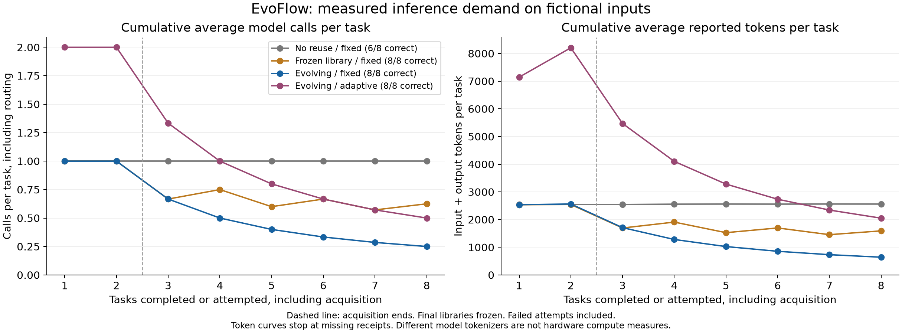
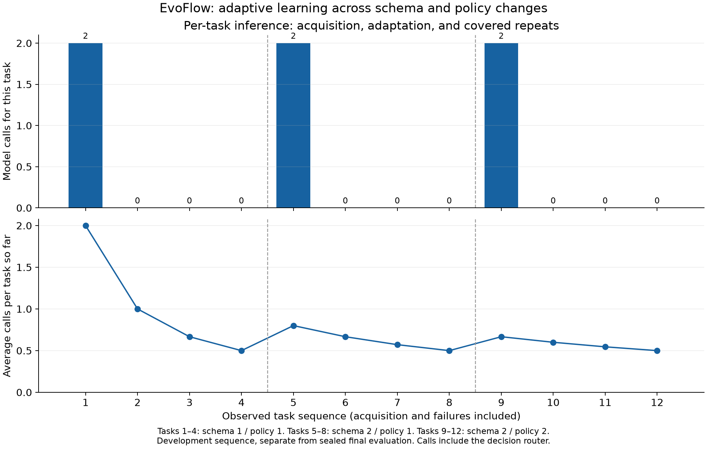

<p align="center"></p>
<h1 align="center">EvoFlow</h1>
<p align="center"><strong>A native Windows companion that turns verified workflows into reusable skills.</strong></p>
<p align="center">WinUI 3 · Python / LangGraph · Local execution · Supabase · Optional LangSmith</p>
<p align="center">
  <a href="#quick-demo">Watch demo</a> · <a href="#meet-evoflow">Tour</a> ·
  <a href="#memory-and-brain-graph">Memory graph</a> · <a href="#workflow-evolution">Evolution</a> ·
  <a href="#set-up-with-your-agent">Agent setup</a> · <a href="#run-from-source">Manual setup</a> ·
  <a href="#benchmarks">Benchmarks</a> · <a href="#validation">Build & test</a> ·
  <a href="#evidence-and-boundaries">Evidence</a> · <a href="#research-and-inspiration">Research</a>
</p>

Talk to a compact desktop island, use registered local tools with native
approvals, and explore the provenance of saved knowledge. In the explicit
reconciliation demo, a model writes a bounded executable plan; independent
checks decide whether it earns a place in the versioned skill library.
Covered fresh inputs can then run locally without another model request.

This working prototype includes limited-scope measured evidence.
It makes no dollar, GPU, energy or general quality claim.

## Quick demo

[](https://github.com/NBTON/EvoFlow/raw/refs/heads/main/docs/media/evoflow-notepad-demo.mp4)

**[Open the full-resolution video — 27 seconds, MP4](https://github.com/NBTON/EvoFlow/raw/refs/heads/main/docs/media/evoflow-notepad-demo.mp4)**

A looping animated preview shows EvoFlow receiving “open the notepad app for me”
and launching Notepad. Click it to open the full-resolution video.

## Meet EvoFlow

<p align="center"></p>
<p align="center"></p>

**Small when idle, useful when open.** Hover to preview, click to keep the panel
open, or press **Ctrl+Alt+E**. Enter sends a message; Shift+Enter adds a line;
Escape collapses the island. Settings, task results and Memory open in native
windows. The notification-area menu offers Open, Memory, Pause/resume, Settings
and Quit. Windows controls whether its icon appears beside the clock or in overflow.

| Available today | What it does |
| --- | --- |
| Conversation and history | Actual provider responses, bounded context within one chat, New Chat isolation, durable local history. |
| Model and effort routing | Typed Decisions routing selects a configured generation model and supported effort. Generation failures surface explicitly. |
| Native local tools | File operations, installed-app discovery/launch, approved console commands, accessible Windows controls, and structured DOCX/PPTX/XLSX/PDF handlers. |
| MCP connections | Native stdio and Streamable HTTP clients, discovery, schema validation, protected credentials and bound approvals for admitted contracts. |
| Memory explorer | Search, filters, pan/zoom, record details and navigation through actual stored provenance/dependency links. |
| Workflow demonstration | Reconcile fictional orders, inventory and shipments; acquire, check, version, reuse and adapt model-authored plans. |
| Optional monitoring | Metadata-only LangSmith traces with run/session correlation and provider usage receipts. |

<details>
<summary><strong>Native Settings</strong></summary>

<p></p>

These are captures of the running Windows application. The graph represents
saved records and recorded links. See [capture provenance and checks](docs/BRANDING-MONITORING-VERIFICATION-2026-10-31.md).

</details>

## Memory and brain graph

[](docs/images/native-memory.png)

See what EvoFlow remembers, where it came from, and what depends on it. Search
and filter saved records, pan or zoom the graph, and select a node to inspect its
provenance. Lines represent recorded relationships; demo/fictional records are
labeled in the interface. Click the screenshot to view it at full size.

## Workflow evolution

Learning lives in external workflow artifacts. **Model weights stay fixed.**
The implemented learning task is order/inventory/shipment reconciliation;
ordinary chat and desktop tool use do not automatically become learned skills.

[](docs/images/workflow-evolution.svg)

<sub>Rendered with <a href="https://github.com/obsidianmd/pele">Pele</a> · <a href="docs/diagrams/workflow-evolution.mmd">Editable diagram source</a></sub>

The model composes generic relational operations such as joins, aggregation,
deduplication and projection. Trusted code validates and interprets the plan;
an independently written oracle checks its result. Failed assumptions block
reuse. Candidates face development/regression checks before promotion, and
prior versions retain provenance and rollback history.

Open the native **Memory** window for the interactive graph explorer: inspect
actual skill versions, sources and dependency edges there. The Pele-rendered SVG
above shows the lifecycle directly on GitHub, with no custom JavaScript.
Build-time instructions in `.agents/skills` are separate from product learning.
Final evaluation feedback stays separate from acquisition and repair.

## Benchmarks

The [reviewed October 31, 2026 findings](docs/evidence/benchmark-20261031-reviewed/reviewed-findings.md)
report real measured executions on **fictional order-reconciliation inputs**.
This is a small sample from one task family, not a general reliability guarantee.
Each controlled condition used the same two acquisition and six held-out final
datasets; acquisition and both failed baseline attempts remain included.

| Condition | Tasks passed | Model calls | Input + output tokens |
| --- | ---: | ---: | ---: |
| No reuse, fixed model | 6/8 | 8 | 20,485 |
| Frozen library, fixed model | 8/8 | 5 | 12,737 |
| Evolving skills, fixed model | 8/8 | 2 | 5,127 |
| Evolving skills + adaptive routing | 8/8 | 4 | 16,411 |

**Fixed-model evolution used 75% fewer calls and 74.97% fewer tokens than no
reuse, including acquisition.** All six final tasks in that condition ran with
zero model inference.



A separate **12-task adaptive sequence** produced skill versions **v1 → v2 → v3**.
All 12 tasks passed. All nine covered repeats—six with fresh records and three
with the exact acquisition input—used **zero model calls and zero inference
tokens**. Schema and policy changes triggered new acquisition/adaptation calls;
local execution and independent verification still perform work.



**Adaptive routing did not demonstrate additional savings over fixed-model
evolution. Dollar savings remain unproven:** the fixed model was free, and
adaptive execution lacked complete cost receipts. No GPU or energy savings
are claimed.

Supporting evidence: [raw results](docs/evidence/benchmark-20261031-reviewed/raw_benchmark.json),
[run accounting](docs/evidence/benchmark-20261031-reviewed/runs.csv),
[predeclared design](docs/evidence/benchmark-20261031-reviewed/manifest.json),
[independent review](docs/evidence/benchmark-20261031-reviewed/review-audit.json)
and [aggregate metrics](docs/evidence/benchmark-20261031-reviewed/totals.json).
[Interrupted setup attempts](docs/evidence/benchmark-20261031-reviewed/interrupted-setup.json)
are disclosed separately, excluded from the controlled estimates, and have
incomplete cost accounting. Historical benchmarks below are separate experiments.

## Architecture

[](docs/images/architecture.svg)

<sub>Rendered with <a href="https://github.com/obsidianmd/pele">Pele</a> · <a href="docs/diagrams/architecture.mmd">Editable diagram source</a></sub>

The native supervisor owns its hidden worker and tool processes. A per-launch
token protects the loopback API. Models cannot bypass native policy, approve
their own actions, register executables or run generated Python/shell/SQL.
Keys and cloud refresh sessions use Windows current-user DPAPI. Supabase connects
automatically with a protected device session; no email/password step or
privileged cloud key is required. Offline changes queue for synchronization.

Read [local tool policy](docs/local-tool-architecture.md),
[current capability boundaries](docs/general-capabilities.md) and
[MCP/Cua architecture](docs/mcp-cua-architecture.md) for the implemented contracts.

## Set up with your agent

Copy this prompt into your coding agent on a **Windows x64 PC**. It prepares
EvoFlow, then opens your private configuration file so you can paste keys locally.

```text
Set up EvoFlow from https://github.com/NBTON/EvoFlow.git on this Windows x64 PC.
Complete the setup you can do without API keys, then open my private key-entry
file as your final action. Never ask me to paste keys into chat.

1. Inspect this PC and any existing EvoFlow checkout. Reuse an existing clone
   where appropriate; otherwise clone into a user-owned development folder.
   Read AGENTS.md, README.md and the current setup guidance. Preserve local
   changes, existing app settings/credentials and shared agent-skill links.

2. Check Git, the .NET SDK required by global.json, uv/Python 3.12 and WinApp CLI
   0.7.1 or later. Use official sources for missing build prerequisites. Report
   any Windows permission or Developer Mode blocker; do not reboot the PC or
   install/trust signing certificates. Do not purchase services or deploy anything.

3. Run scripts/Setup.ps1, the repository's Python tests and Ruff checks, and:
   dotnet build native/EvoFlow/EvoFlow.csproj -p:Platform=x64
   Launch the native app with WinApp CLI and check that its window and local
   worker start. Do not send paid model requests or run live demos/benchmarks.
   If the supported pinned Cua runtime is already installed, follow the repo's
   Sync-CuaRuntime.ps1 guidance and rebuild. Otherwise report that optional
   capability as unavailable without blocking the basic app setup.

4. Prepare %LOCALAPPDATA%\EvoFlow\provider-keys.env, outside the checkout.
   Create its directory if needed. For a new file, copy the blank assignments
   and explanatory comments from .env.example. For an existing file, preserve
   all values and add only missing blank placeholders, with no duplicate names.
   Never print, screenshot, commit or put credential values in command arguments.
   Do not copy credentials or device sessions from another person or machine.

5. Explain which fields I need: OPENROUTER_API_KEY for Decisions routing, plus
   credentials for at least one enabled generation provider in config/runtime.json.
   The OpenRouter key can also serve an enabled OpenRouter generation model;
   DEEPSEEK_API_KEY and MIMO_API_KEY are only needed for their direct providers.
   Mark MIMO_BASE_URL for account-specific endpoint selection; do not guess it.
   LANGSMITH_API_KEY is optional; leave monitoring disabled unless I request it.
   Supabase uses its automatic protected device session, with no password entry.

6. Before opening the file, give me a short setup/checks summary, its actual
   absolute path, the key fields to fill, and any unresolved blockers. Tell me
   to save, fully quit EvoFlow from its tray menu, and relaunch after adding keys.
   Distinguish a successful local launch from unverified provider connectivity.

7. Finally, open that exact provider-keys.env file in a visible local editor
   (use Notepad if no suitable editor is available), with OPENROUTER_API_KEY
   clearly identified. Leave it open for me to paste my keys. Do not read or
   capture its contents afterward, and do not wait for keys in chat.
```

Fill only the providers you intend to use; you do not need every key. Provider
usage may incur charges. After saving, restart EvoFlow to import nonempty keys
into Windows DPAPI. Optional monitoring setup is [explained below](#optional-langsmith-monitoring).

## Run from source

Use **Windows x64**, Developer Mode, [.NET SDK 10.0.403](global.json),
**WinApp CLI 0.7.1+**, [uv](https://docs.astral.sh/uv/getting-started/installation/)
and Python 3.12. Dependency versions are pinned in `uv.lock` and native lockfiles.

```powershell
git clone https://github.com/NBTON/EvoFlow.git
cd EvoFlow
.\scripts\Setup.ps1
dotnet build native/EvoFlow/EvoFlow.csproj -p:Platform=x64
winapp run native/EvoFlow/EvoFlow.csproj --arch x64 -p Platform=x64 --detach --json
```

Setup restores locked dependencies and writes this checkout's ignored worker
location. Development builds can use `.venv`; self-contained delivery includes
its own Python runtime.

1. Copy the empty assignments from [`.env.example`](.env.example) into
   `%LOCALAPPDATA%\EvoFlow\provider-keys.env` and fill the providers you use.
   Native Settings also accepts the OpenRouter key. Keep the entry file private.
2. Restart after editing it. Nonempty keys import into DPAPI; blank assignments
   preserve protected keys.
3. Type a message, or open **Settings → Demos → Run sample demonstration**.
   The demo explicitly uses fictional data; ordinary messages never silently
   receive a sample dataset. Attach JSON accepts the supported
   [dataset contract](worker/evoflow_worker/domain.py).
4. Use **New Chat**, **History**, **Memory**, **View results** and **Export evidence**
   to inspect the corresponding saved state.

Adaptive routing needs an OpenRouter Decisions credential plus at least one
enabled generation provider in [`config/runtime.json`](config/runtime.json).
Choose the MiMo endpoint matching your account. Configured models may incur
provider charges; there is no silent generator substitution.

<details>
<summary><strong>Bundled Cua and development delivery</strong></summary>

The managed Calculator capability requires Windows Calculator and the pinned
Cua Driver 0.38.0 installation. `Sync-CuaRuntime.ps1` checks the existing
installation's hashes and copies its binaries and MIT notice into the ignored
runtime directory. See [MCP/Cua setup](docs/mcp-cua-architecture.md) for scope.

```powershell
.\scripts\Sync-CuaRuntime.ps1
.\scripts\Build-Delivery.ps1
```

`Build-Delivery.ps1` prepares embedded CPython 3.12.10 and locked dependencies,
then uses WinApp CLI to build a self-contained x64 MSIX and extracted layout
under `delivery/`. Launch the layout with its generated `Launch.ps1`.
`Sync-BundledRuntime.ps1` refreshes an existing embedded runtime after dependency
changes; `Build-Delivery.ps1 -SkipRuntime` reuses a prepared runtime.

This is **unsigned development delivery** requiring Developer Mode and WinApp CLI.
Production signing, a trusted installer and clean-machine validation remain
separate work. These build instructions do not install a certificate.

</details>

## Optional LangSmith monitoring

EvoFlow works with monitoring disabled. In the private entry file, set
`LANGSMITH_API_KEY`, enable `LANGSMITH_TRACING=true`, and use
`LANGSMITH_PROJECT=EvoFlow`. The US endpoint is
`https://api.smith.langchain.com`; EU workspaces use
`https://eu.api.smith.langchain.com`. `LANGSMITH_WORKSPACE_ID` can stay blank
unless your key needs explicit workspace selection. Restart the app to apply.

Traces contain named conversation/workflow runs, correlated provider spans,
requested/submitted effort, status and measured token receipts. Prompts,
responses, datasets, plans, tool payloads, private reasoning and exception text
stay out of traces. Missing provider costs remain unknown; dashboard pricing
estimates are distinct from provider bills. See [monitoring setup and live verification](docs/monitoring.md).

## Validation

```powershell
uv sync --frozen
.venv/Scripts/python.exe -m pytest -q
.venv/Scripts/python.exe -m ruff check worker tests scripts
.venv/Scripts/python.exe -m ruff format --check worker tests scripts
dotnet build native/EvoFlow/EvoFlow.csproj -p:Platform=x64
dotnet run --project native/EvoFlow.ToolHost.Tests/EvoFlow.ToolHost.Tests.csproj
dotnet run --project native/EvoFlow.Connectors.Tests/EvoFlow.Connectors.Tests.csproj
```

Native verification uses WinApp CLI against the launched application. Scripts
in [`scripts/`](scripts/) cover island geometry, Settings, Memory navigation,
conversation isolation and local tool acceptance. Some send live requests or
exercise native approvals; inspect their scope before running them. Current
checks and package integrity are in [the delivery report](docs/BRANDING-MONITORING-VERIFICATION-2026-10-31.md).

## Evidence and boundaries

| Category | Status and evidence |
| --- | --- |
| Implemented product | Native chat/history, scoped local tools, Memory, routing, optional monitoring and native MCP connections. [Current delivery checks](docs/BRANDING-MONITORING-VERIFICATION-2026-10-31.md). |
| Explicit learning demo | Fictional reconciliation, model-authored candidate admission and verified fresh-input reuse. [Development evidence](docs/evidence/multi-provider-workflow-20261030T220759Z.json). |
| Latest reviewed benchmark | Fixed-model evolution reduced calls by 75% and tokens by 74.97%, including acquisition; small fictional workload. [Reviewed findings](docs/evidence/benchmark-20261031-reviewed/reviewed-findings.md) and [summary above](#benchmarks). |
| Historical experiment | Preliminary fixed-policy comparison, separate from current adaptive routing. [Aggregate report](docs/evidence/benchmark.md); raw sealed final rows/feedback are not published. |
| Browser limits | Playwright tooling is implemented, but the latest retained Chrome startup check failed. Managed Cua browser preparation is blocked by an ownership refusal. [Exact outcomes](docs/MCP-CUA-VERIFICATION-2026-10-31.md). |
| Planned / unverified | Voice, continuous screen capture, general browser/desktop autonomy, full MCP resource/prompt/sampling compatibility, production signing and clean-machine installation. |

The historical experiment included two acquisition and six final tasks per
condition. Observed correct-task/model-call totals were **7/8 and 8** without
reuse, **8/8 and 4** with a frozen library, and **8/8 and 2** with an evolving
library. Acquisition is included. These small observations do not establish
general reliability, routing optimality or hardware/cost savings.
Direct-provider cost reporting is incomplete, and provider availability changes.

## Research and inspiration

These papers and official documentation informed EvoFlow's approach to reusable
workflows, external procedural knowledge and persistent execution state.

| Source | Connection to EvoFlow |
| --- | --- |
| [**Prime Agent: A Self-Improving RLM Harness**](https://arxiv.org/pdf/2608.23552) (2026) | Inspired persistent skills and memory outside model weights, with explicit execution, verification and resource accounting in the agent harness. |
| [**Agent Workflow Memory**](https://arxiv.org/pdf/2409.07429) (2024) | Inspired learning reusable workflows from prior task experience and applying them to subsequent tasks. |
| [**Hermes Agent — Skills System**](https://hermes-agent.nousresearch.com/docs/user-guide/features/skills) | Informed agent-authored, on-demand procedural knowledge stored as reusable external artifacts. |
| [**LangGraph — Persistence**](https://docs.langchain.com/oss/python/langgraph/persistence) | Guided checkpointed graph state and the separation of thread state from durable knowledge. EvoFlow uses local SQLite checkpoints and separate skill, knowledge and preference records. |

EvoFlow applies these ideas to a scoped reconciliation task family, with fixed
model weights and independently checked, versioned executable plans. It does not
reproduce the complete Prime Agent or Agent Workflow Memory systems or claim
their published benchmark results. Checkpoints preserve execution state; skill
learning and admission are separate application mechanisms.

<details>
<summary><strong>Project references</strong></summary>

- [Complete build brief](docs/brief/AI-Workflow-Hackathon-Build-Brief.md)
- [Current delivery verification](docs/BRANDING-MONITORING-VERIFICATION-2026-10-31.md)
- [Provider contracts](docs/model-provider-contracts.md)
- [MCP/Cua verification and remaining gaps](docs/MCP-CUA-VERIFICATION-2026-10-31.md)
- [Installed skill provenance](skills-lock.json)
- [Clicky](https://github.com/farzaa/clicky) informed the compact interaction.
  All EvoFlow product surfaces remain native WinUI.

</details>
