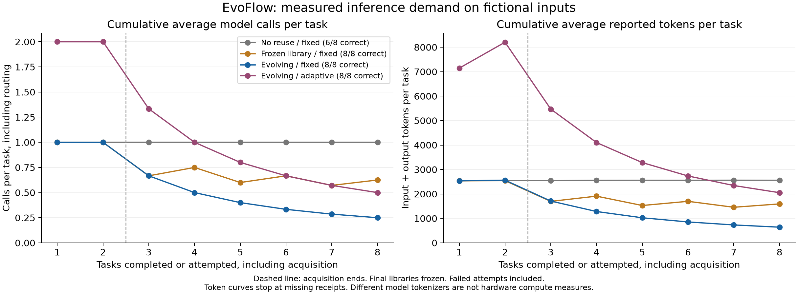
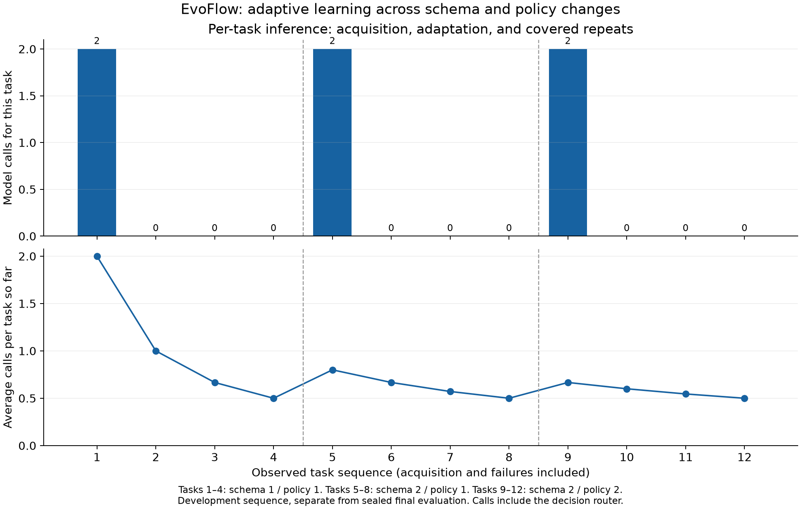

# EvoFlow benchmark findings — October 31, 2026

**Learning and checked skill evolution reduced inference demand on this workload. Additional savings from smart routing were not demonstrated.** The inputs are fictional order data generated from the judge-demo task family. Every outcome below is a real product-worker execution; no measured outcomes or costs were fabricated.

## Controlled comparison

Each condition received the same two acquisition datasets and six new held-out final datasets: eight tasks with 12 logical orders each, balanced between schema 1 and schema 2 with split shipments. Each condition had a fresh isolated local store. Acquisition costs and both failed baseline attempts remain included.

| Condition | Correct / all tasks | Correct / sealed final | Model calls | Input + output tokens | Billed model cost |
|---|---:|---:|---:|---:|---|
| No reuse, fixed model | 6/8 | 4/6 | 8 (8 generation + 0 routing) | 20,485 | $0.00 reported |
| Frozen library, fixed model | 8/8 | 6/6 | 5 (5 generation + 0 routing) | 12,737 | $0.00 reported |
| Evolving skills, fixed model | 8/8 | 6/6 | 2 (2 generation + 0 routing) | 5,127 | $0.00 reported |
| Evolving skills + adaptive routing | 8/8 | 6/6 | 4 (2 generation + 2 routing) | 16,411 | Unknown; incomplete cost receipts |

- Evolving skills with the fixed model used **75% fewer model calls** (8 → 2) and **74.97% fewer tokens** (20,485 → 5,127) than no reuse. All eight evolving tasks passed, compared with six baseline tasks. This is a descriptive small-sample result, not a statistical quality guarantee.
- Compared with a frozen library, evolution reduced calls from 5 to 2 because it acquired coverage for the second schema. All six final datasets then ran at zero inference.
- Fixed-model evolution averaged **640.88 tokens per attempted task**, including acquisition, versus **2,560.62** without reuse. Per successful task, including the failed attempts' expenditure, these values were 640.88 and 3,414.17 respectively.
- Mean worker latency on the six final tasks was 12.890s without reuse, 0.092s for evolving fixed, and 0.090s for evolving adaptive. These timings exclude native startup and cloud synchronization and are not a speed guarantee.

## The same task becomes cheaper after learning

A separate adaptive development sequence tested three contracts: schema 1 / policy 1; schema 2 with split shipments / policy 1; schema 2 / policy 2 with two grace days. Each phase used one acquisition or adaptation, two fresh-record repeats, then a literal repeat of the acquisition input.

| Phase / observed skill | Acquisition or adaptation calls | Acquisition or adaptation tokens | Calls on the next three runs | Average tokens/task after four runs |
|---|---:|---:|---|---:|
| phase_1 / v1 | 2 | 6,991 | 0 / 0 / 0 | 1,747.75 |
| phase_2 / v2 | 2 | 10,093 | 0 / 0 / 0 | 2,523.25 |
| phase_3 / v3 | 2 | 7,696 | 0 / 0 / 0 | 1,924.00 |

All **12/12** longitudinal tasks passed. Skills progressed **v1 → v2 → v3**. Every one of the **nine covered repeats** used **zero model calls and zero inference tokens**, including all three exact-input repeats. The other six repeats had new input hashes and new order records; the saved procedure computed their answers rather than replaying a cached response. Exact repeats matched both input hash and output.

Within each phase, cumulative average calls were **2 → 1 → 0.67 → 0.5 per task**. Average inference tokens fell **75% after four executions**, with acquisition included. Marginal inference falls to zero on the first covered reuse and stays there; it does not keep decreasing below zero. Schema and policy changes caused new two-call spikes. Local execution, retrieval, storage and independent verification still perform work.

## What smart routing showed

The adaptive condition used two generation calls plus two routing calls, compared with two generation calls for fixed-model evolution. Both adaptive acquisitions selected **DeepSeek Flash with submitted high effort** through **Joey** routing. Provider-effective effort remains unknown. This run did not demonstrate switching among multiple generation models.

Adaptive evolution used **16,411 tokens**, versus **5,127** for fixed evolution: **220.1% more reported tokens**, with twice as many model calls. Router receipts account for 2,703 of the adaptive tokens; reasoning accounts for 8,813 output tokens and is already included in the total. These counts support reporting routing overhead, not claiming extra routing savings.

Adaptive evolution used fewer calls/tokens than the no-reuse baseline overall, but learning, model choice, effort, output budgets and tokenizer all differ in that comparison. It does not isolate a causal routing benefit. A future comparison needs the same eligible model pool, a nonadaptive provider/effort control and repeated randomized trials with comparable quality.

## Cost interpretation

All fixed-model cost receipts were $0.00 because that control uses a free model. Adaptive token usage receipts were complete, but DeepSeek execution costs were not supplied. The paired adaptive receipts contain only **$0.00002697 of reported routing charges**; that is a partial sum, not the full run cost. Therefore **actual dollar savings have not been established**. No dollar, GPU, FLOP, power or energy savings are claimed. Tokens and calls measure inference demand, and different tokenizers are not hardware compute measurements.

## Evidence and limitations

- Manifest seeds and conditions were written before controlled execution. All four final skill-library hashes were independently checked unchanged. No skill's acquisition source was a final run. Final inputs may be submitted for synthesis where no skill applies, but final expected answers and verification feedback did not drive repairs or promotion: final runs use learning=False.
- All 42 successful outputs across 44 controlled runs were independently reverified against the original generated inputs. The two failed no-reuse tasks, seeds 30213 and 30215, violated the exact seven-column output contract. No failed run was replaced.
- This is one operational task family, eight paired datasets, six final datasets, one pass per condition, and one 12-run development sequence. Conditions ran sequentially; provider variability and task ordering can affect timings. The longitudinal results are separate from held-out quality results. No accuracy percentage here establishes general reliability.
- Old-case development checks ran before promotion. The current library stores one current contract per schema, so v3 passing regression checks does not prove that every prior schema/policy combination remains reusable.
- Two overlapping delegation executions were interrupted before the controlled run. Three partial records are retained in interrupted-setup.json and the original isolated stores: one recorded completed model call plus two working records with potentially unpersisted in-flight usage. Their full costs are unknown. This is extra experiment setup overhead, excluded from the controlled paired estimates and disclosed rather than erased. Harness-authoring Gemini/Codex work is also outside product-run inference totals.
- The initial harness was authored using Gemini 3.8 Flash High via agy; Codex reviewed and corrected accounting/reporting and executed the single controlled process. Saved application state, production code and native UI were not changed. No cloud sync, push, deployment or submission was performed.

Validation: uv sync --frozen; **166 Python tests passed**; repository Ruff checks and formatting for the added scripts passed; budget guard checked for failed-attempt accounting and retry reservation; paired input hashes, frozen libraries, literal repeats and secret-free JSON evidence checked. Both figures were rendered and visually inspected.

## Judge-ready wording

> On this preliminary fictional order-reconciliation benchmark, EvoFlow's learned and evolved workflows reduced model calls by 75% and reported tokens by about 75%, including acquisition, while passing all eight tasks. After learning each contract, both exact-task repeats and fresh-record repeats required zero model inference. Schema and policy changes triggered checked revisions before reuse. Adaptive routing worked, but this experiment did not show an additional cost saving from routing.

Sources: manifest.json, raw_benchmark.json, runs.csv, totals.json, review-audit.json and interrupted-setup.json in this directory. Historical benchmark files and the Desktop demo guide supplied context only; their results were not mixed into these measurements.
